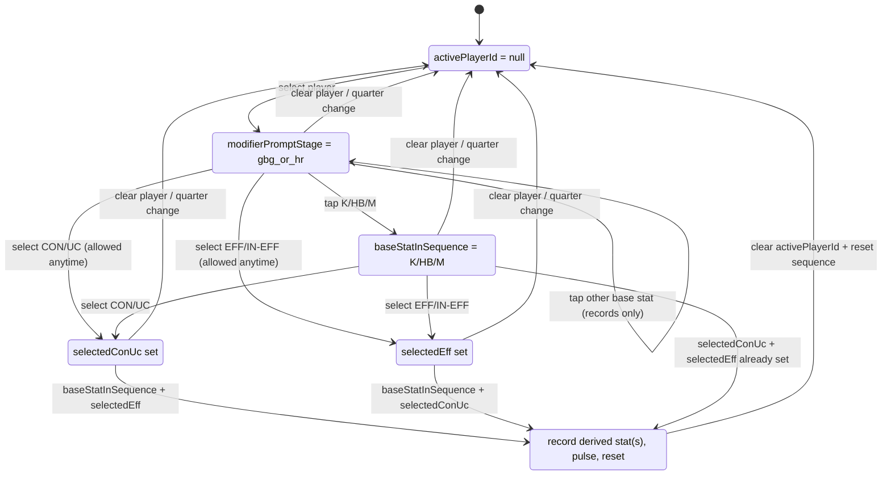

# Stats Sequencing (Single Player Tracker)

Last verified: 2026-07-23
Source of truth: active handlers in `app/new-game/team-tracker/game.tsx`, `components/team-tracker/PhoneTeamTracker.tsx`, and `app/tracker.tsx`

## Purpose
Document the exact stat sequencing behavior used by the iPad Team Tracker UI so it can be re-implemented without guessing. This covers the single-player stat flow (select player → optionally choose modifiers → record base stats) and explicitly excludes timer behavior. Source of truth is `app/new-game/team-tracker/game.tsx`.

## Definitions
- Base stat: Any stat in the main grid (`STAT_BUTTONS`), i.e. `K`, `HB`, `M`, `T`, `G`, `B`, `FF`, `FA`, `CL`, `I50`, `R50`, `HO`, `TO`, `INT`, `ONE_PERCENT`, `GA`. Modifiers are not base stats. (See `STAT_BUTTONS` around `game.tsx:181-200`.)
- Modifier: The stat-group pills `GBG`, `HR`, `CON`, `UC`, `EFF`, `IN-EFF` rendered by `StatGroupSelector` and handled by `handleSelectModifier`. (See `game.tsx:1765-1904` and `game.tsx:3115-3141`.)
- Active player: The currently selected player ID from the tracker store (`activePlayerId`), required to record base stats. (Store at `lib/game-tracker-store.ts:109-165`, UI usage at `game.tsx:2364-2383` and `game.tsx:3816-3824`.)
- Sequencing lock: The requirement that a player be active before base stats can be recorded. The lock is enforced by disabling the stat grid and by early-returns in `handlePressStat`. (See `StatPadGrid disabled` at `game.tsx:3816-3824` and guard at `game.tsx:3016-3025`.)

## State Model
State that directly controls sequencing (local React state unless noted):
- `activePlayerId: string | null` (Zustand store):
  - Lives in `useGameTrackerStore`. Initialized to `null` in store and updated by `setActivePlayer`. (Store definition `lib/game-tracker-store.ts:109-165`.)
  - Set on hydration when there are existing events: `setActivePlayer(hasExistingEvents ? mappedSelected.home[0]?.gamePlayerId ?? null : null)` (approx `game.tsx:2711-2713`).
  - Set by player selection in iPad layout: `handleSelectPlayer` sets it and then primes/reset sequencing. (Approx `game.tsx:2985-2993`.)
  - Cleared on quarter change (`handleSelectQuarter`), sequence completion (`handleSequenceResetAfterAnimation`), and when active player is removed from roster (`handleApplyPlayerEdits`). (Approx `game.tsx:2590-2595`, `game.tsx:2995-2999`, `game.tsx:3414-3419`.)
- `selectedModifier: string | null`:
  - Tracks the last non-GBG/HR modifier pill selection (and is also used for CON/UC and EFF/IN-EFF). Initialized to `null`. (Approx `game.tsx:2388`.)
  - Updated in `handleSelectModifier` for `CON`, `UC`, `EFF`, `IN-EFF`, and any default case; reset in `resetSequenceState` and when selecting `GBG/HR`. (Approx `game.tsx:2451-2459`, `game.tsx:3115-3141`.)
- `modifierPromptStage: 'none' | 'gbg_or_hr' | 'con_or_uc' | 'eff_or_ineff'`:
  - Controls which modifier pills should glow (prompt). Initialized to `none`. (Type at `game.tsx:286`, state at `game.tsx:2389`.)
  - Set to `gbg_or_hr` when a player is selected via `primeSequenceForPlayer`. (Approx `game.tsx:2461-2464` and `game.tsx:2985-2993`.)
  - Progresses to `con_or_uc` when a base stat `K/HB/M` is recorded. (Approx `game.tsx:3050-3057`.)
  - Progresses to `eff_or_ineff` when `CON/UC` is selected while in `con_or_uc` stage. (Approx `game.tsx:3125-3131`.)
  - Cleared to `none` on `GBG/HR` selection (if prompting), on sequence complete, on quarter change, and on player change. (Approx `game.tsx:3115-3121`, `game.tsx:3001-3004`, `game.tsx:2590-2595`, `game.tsx:2985-2993`.)
- `selectedGbgHr: 'GBG' | 'HR' | null`, `selectedConUc: 'CON' | 'UC' | null`, `selectedEff: 'EFF' | 'IN-EFF' | null`:
  - Track which modifier pill within each sub-group is selected for sequencing and visual state. (Initialized at `game.tsx:2390-2392`.)
  - Set in `handleSelectModifier`, reset in `resetSequenceState`. (Approx `game.tsx:3115-3138` and `game.tsx:2451-2459`.)
- `baseStatInSequence: 'K' | 'HB' | 'M' | null`:
  - Records the first `K/HB/M` base stat in the current sequence for derived modifier logic and UI highlight. (Initialized at `game.tsx:2393`.)
  - Set the first time `K/HB/M` is recorded in the sequence. (Approx `game.tsx:3050-3054`.)
  - Cleared on sequence reset (player change, quarter change, or sequence complete). (Approx `game.tsx:2451-2459` and `game.tsx:2995-2999`.)
- `sequenceAnimatingComplete: boolean` and `sequencePulse: Animated.Value`:
  - Control the short “sequence complete” pulse. (Initialized at `game.tsx:2394-2395`.)
  - Set to `true` in `triggerSequenceComplete`, then reset and active player cleared in `handleSequenceResetAfterAnimation`. (Approx `game.tsx:3001-3013` and `game.tsx:2995-2999`.)

Derived UI state (computed from state above):
- `shouldFlashModifier(group)` returns whether a modifier should glow based on `modifierPromptStage` and whether a choice has already been made for that stage. (Approx `game.tsx:3179-3191`.)
- `isModifierSelected(group)` picks the “selected” state from the specific selection buckets. (Approx `game.tsx:3193-3198`.)
- `isModifierPulsing(group)` returns true during the completion pulse for the chosen modifier. (Approx `game.tsx:3200-3205`.)
- `isStatPulsing(key)` returns true during the completion pulse for the base stat. (Approx `game.tsx:3208-3209`.)
- Stat grid disabled state derives from `!activePlayerId`. (Approx `game.tsx:3816-3824`.)

## UI Gating Rules
| Control | Enabled when | Disabled when | Visual hint (glow/border) | Code reference |
| --- | --- | --- | --- | --- |
| Player grid (iPad) | Always enabled; selection triggers sequencing reset/prime | N/A | Selected player highlight handled by `PlayerGrid` | `game.tsx:3767-3773` + `handleSelectPlayer` at `game.tsx:2985-2993` |
| Base stat grid (`STAT_BUTTONS`) | `activePlayerId` is set | `activePlayerId` is `null` (grid disabled + opacity) | Selected `K/HB/M` shows bordered highlight when `baseStatInSequence` is set and not animating | `StatPadGrid` in `game.tsx:1907-1975` and use at `game.tsx:3816-3824` |
| Modifier pills (`GBG/HR/CON/UC/EFF/IN-EFF`) | Always enabled (no disabled prop) | N/A | Prompt glow when `modifierPromptStage` expects a choice; neon outline when selected; pulse on sequence completion | `StatGroupSelector` in `game.tsx:1765-1904` + `shouldFlashModifier` at `game.tsx:3179-3191` |
| Undo button | `events.length > 0` | `events.length === 0` | Opacity drop when disabled | `game.tsx:3789-3796` + `handleUndo` at `game.tsx:3152-3162` |

Note: `GBG/HR` taps call `handlePressStat`, which hard-blocks if no `activePlayerId` (toast/alert). (See `handleSelectModifier` at `game.tsx:3115-3123` and guard at `game.tsx:3016-3025`.)

## Sequencing Flow
### Player selection
- Initial state (new game with no events): `activePlayerId` is `null`; sequencing state is `none`/`null` by default. (Store init `lib/game-tracker-store.ts:146-165`; local state at `game.tsx:2388-2394`.)
- If the game is hydrated with existing events, the first home player is auto-selected, but sequencing is not primed (no `gbg_or_hr` prompt until user re-selects). (See `setActivePlayer(...)` at `game.tsx:2711-2713` and note `primeSequenceForPlayer` is only called from `handleSelectPlayer`.)
- Selecting a player in the iPad UI:
  - `handleSelectPlayer` sets `activePlayerId`, starts the quarter timer, and primes sequencing by clearing any prior selection and setting `modifierPromptStage` to `gbg_or_hr`. (Approx `game.tsx:2985-2993` and `game.tsx:2461-2464`.)
- Switching players:
  - Re-running `handleSelectPlayer` clears all modifier/base selection state and re-primes `gbg_or_hr`. (Same references as above.)
- Clearing active player:
  - Selecting `null` (or after sequence completion) resets all sequencing state (`resetSequenceState`) and leaves `activePlayerId` null. (Approx `game.tsx:2990-2999`.)

### Modifier selection
Modifier pills are always pressable. Their behavior depends on which pill is tapped:
- `GBG` / `HR`:
  - Immediately recorded as an event via `handlePressStat(group)`. (Approx `game.tsx:3115-3118`.)
  - `selectedGbgHr` is set to the tapped key. If currently prompting `gbg_or_hr`, the prompt stage is cleared to `none`. (Approx `game.tsx:3118-3121`.)
  - `selectedModifier` is cleared to `null`. (Approx `game.tsx:3122`.)
- `CON` / `UC`:
  - Sets `selectedConUc` and `selectedModifier` to the selected key. (Approx `game.tsx:3125-3127`.)
  - If prompt stage is `con_or_uc`, it advances to `eff_or_ineff`. (Approx `game.tsx:3128-3131`.)
  - Calls `maybeTriggerSequenceComplete` to check if base stat + `EFF/IN-EFF` are already chosen. (Approx `game.tsx:3131-3149`.)
- `EFF` / `IN-EFF`:
  - Sets `selectedEff` and `selectedModifier`. (Approx `game.tsx:3134-3137`.)
  - Calls `maybeTriggerSequenceComplete` to check if base stat + `CON/UC` are already chosen. (Approx `game.tsx:3134-3149`.)

Modifiers do not count as base stats. Only `handlePressStat` on `STAT_BUTTONS` records base stats, and only `K/HB/M` are treated as “sequencing bases” that unlock derived modifier behavior. (See `STAT_BUTTONS` at `game.tsx:181-200` and `handlePressStat` at `game.tsx:3050-3060`.)

### Base stat recording
- Any base stat tap (`STAT_BUTTONS`) calls `handlePressStat(statKey)`:
  - Requires `activePlayerId`; otherwise it shows a toast/alert and returns. (Approx `game.tsx:3016-3025`.)
  - Records the stat as an event (always, regardless of sequencing state). (Approx `game.tsx:3031-3049`.)
- Special sequencing behavior for `K`, `HB`, and `M`:
  - On the first `K/HB/M` in a sequence, `baseStatInSequence` is set to that key. (Approx `game.tsx:3050-3054`.)
  - If the prompt stage is `none` or `gbg_or_hr`, it advances to `con_or_uc`. (Approx `game.tsx:3055-3057`.)
  - If `baseStatInSequence` (or the current stat key) and both `selectedConUc` + `selectedEff` are already chosen, sequence completion is triggered immediately. (Approx `game.tsx:3051-3060`.)
- Base stats other than `K/HB/M` do not affect sequencing state (no prompt stage change, no base selection set). This is implicit because only those keys are handled in the `if` block. (Approx `game.tsx:3050-3060`.)

### Sequence completion
Sequence completion happens when all of the following are true:
- `baseStatInSequence` is set (must be `K/HB/M`).
- `selectedConUc` is set (`CON` or `UC`).
- `selectedEff` is set (`EFF` or `IN-EFF`).

When completion is detected (either after base stat tap or after selecting CON/UC or EFF/IN-EFF):
- Derived modifier stats are recorded based on `baseStatInSequence`:
  - `K` → `K_EF` or `K_IF`
  - `HB` → `HB_EF` or `HB_IF`
  - `M` → `MC` or `MUC`
  (See `recordDerivedModifierStats` at `game.tsx:3068-3113`.)
- A short pulse animation runs (`sequenceAnimatingComplete = true`), then sequencing state is reset and `activePlayerId` is cleared. (See `triggerSequenceComplete` at `game.tsx:3001-3013` and `handleSequenceResetAfterAnimation` at `game.tsx:2995-2999`.)

## Quarter Behavior
- `currentQuarter` is stored in the tracker store. (See `lib/game-tracker-store.ts:109-165`.)
- Changing quarters via `handleSelectQuarter`:
  - Pauses quarter timers (not part of sequencing).
  - Sets `currentQuarter` in the store.
  - Clears the active player and resets all sequencing state (`resetSequenceState`).
  (See `game.tsx:2590-2595`.)
- No other automatic per-quarter reset of events or modifiers exists outside this explicit reset. Any state not cleared here persists across quarters.

## Undo Behavior
- `handleUndo` removes the most recent event from the store and database but does not restore or adjust any sequencing state (`activePlayerId`, modifiers, base stat selection). (See `game.tsx:3152-3162`.)
- Therefore, undo does not rewind modifier prompts, base selection, or active player selection. Sequencing state remains as-is after undo.

## Visual Hints (Glow)
- Modifier prompt glow:
  - Controlled by `modifierPromptStage` in `shouldFlashModifier`. When a stage is active and its choice is unset, the corresponding pill(s) glow and pulse. (See `game.tsx:3179-3191`.)
  - Visual treatment is applied in `StatGroupSelector` with bright green background, shadow, and pulsing scale. (See `game.tsx:1831-1896`.)
- Modifier selected state:
  - Selected pills use a neon outline (no glow pulse) via `isModifierSelected`. (See `game.tsx:1870-1894` and `game.tsx:3193-3198`.)
- Base stat highlight:
  - When `baseStatInSequence` is set and the sequence is not animating, the matching `K/HB/M` button shows a border and shadow. (See `StatPadGrid` at `game.tsx:1937-1959`.)
- Sequence completion pulse:
  - While `sequenceAnimatingComplete` is true, the selected base stat and selected modifier pills pulse using `sequenceCompleteStyle`. (See `isModifierPulsing` at `game.tsx:3200-3205`, `isStatPulsing` at `game.tsx:3208-3209`, and usage in `StatGroupSelector`/`StatPadGrid` at `game.tsx:1842-1847` and `game.tsx:1940-1941`.)

## Implementation Map (Where in code)
- Base stat list + labels: `STAT_BUTTONS` definition in `app/new-game/team-tracker/game.tsx:181-200`.
- Sequencing state variables (local): `TeamTrackerGameScreen` state block in `game.tsx:2385-2427`.
- Sequencing reset + prime: `resetSequenceState` and `primeSequenceForPlayer` in `game.tsx:2451-2464`.
- Player selection behavior (iPad): `handleSelectPlayer` in `game.tsx:2985-2993`.
- Base stat recording + sequencing progression: `handlePressStat` in `game.tsx:3016-3065`.
- Modifier selection + completion checks: `handleSelectModifier` and `maybeTriggerSequenceComplete` in `game.tsx:3115-3149`.
- Derived modifier event creation: `recordDerivedModifierStats` in `game.tsx:3068-3113`.
- Sequence completion animation + reset: `triggerSequenceComplete` and `handleSequenceResetAfterAnimation` in `game.tsx:2995-3013`.
- Modifier glow/selection/pulse derivations: `shouldFlashModifier`, `isModifierSelected`, `isModifierPulsing` in `game.tsx:3179-3205`.
- Base stat grid gating and highlight: `StatPadGrid` in `game.tsx:1907-1975` and usage in `game.tsx:3816-3824`.
- Quarter change reset: `handleSelectQuarter` in `game.tsx:2590-2595`.
- Store fields used by sequencing: `activePlayerId`, `currentQuarter`, `events` in `lib/game-tracker-store.ts:102-165`.

## Mermaid State Diagram

## Example Walkthroughs
1) Standard prompted flow (GBG → base stat → CON → EFF):
- Start of quarter with no active player.
- Select a player → `modifierPromptStage` becomes `gbg_or_hr` and GBG/HR pills glow. (`game.tsx:2985-2993`, `game.tsx:3179-3183`.)
- Tap `GBG` → records `GBG` event, sets `selectedGbgHr`, clears the `gbg_or_hr` prompt stage. (`game.tsx:3115-3121`.)
- Tap `K` → records `K`, sets `baseStatInSequence = K`, advances prompt to `con_or_uc`. (`game.tsx:3050-3057`.)
- Tap `CON` → sets `selectedConUc`, advances prompt to `eff_or_ineff`. (`game.tsx:3125-3131`.)
- Tap `EFF` → sets `selectedEff`, records derived `K_EF`, triggers completion pulse, and clears active player and all sequence state. (`game.tsx:3134-3149`, `game.tsx:3068-3113`, `game.tsx:2995-3013`.)

2) Modifiers first, base stat later:
- Select player (prompt stage = `gbg_or_hr`).
- Tap `CON`, then `EFF` before any base stat → `selectedConUc` and `selectedEff` are set, prompt stage advances to `eff_or_ineff`, but no completion yet because `baseStatInSequence` is null. (`game.tsx:3125-3138` and `game.tsx:3143-3149`.)
- Tap `HB` → records `HB`, sets `baseStatInSequence = HB`, sees both `selectedConUc` + `selectedEff` already set, and triggers completion (recording `HB_EF` or `HB_IF` depending on selection). (`game.tsx:3050-3060` and `game.tsx:3068-3113`.)

## Differences
No separate single-player sequencing implementation exists in this file. The sequencing state and handlers described above are shared by both iPad and phone layouts in `game.tsx` (phone delegates UI to `PhoneTeamTracker` but uses the same handler functions for sequencing). No alternate single-player logic was found in this repo section.
