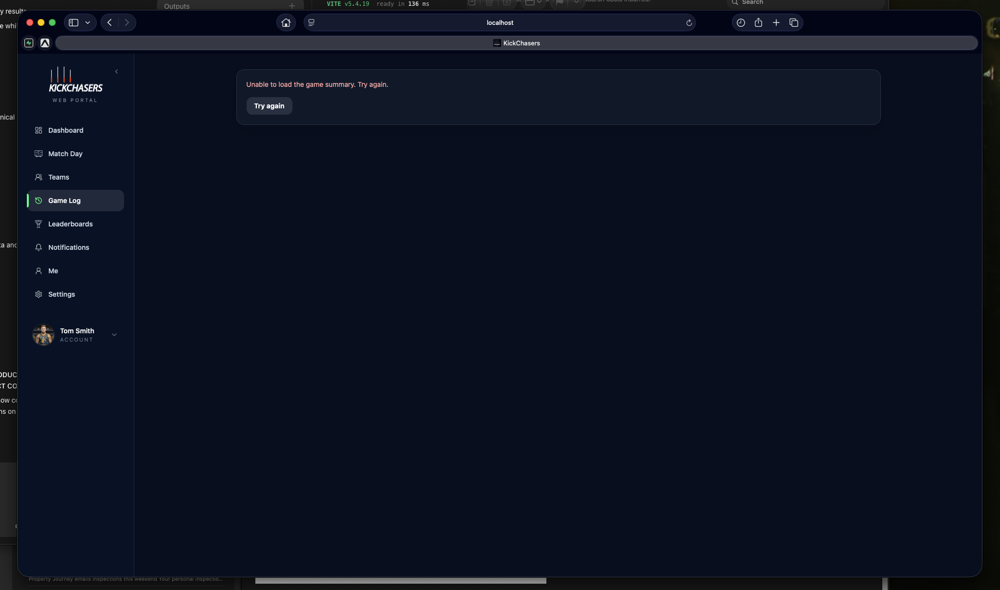

# Final Web/Mobile Parity & Release Audit

Audit date: 13 September 2026  
Scope: current web routes and repositories, completed parity reports, current mobile documentation/source, deployed Supabase schema probes, the supplied failed-summary screenshot, narrow-browser inspection, and the complete web validation suite.  
Constraint: no migration, schema, RLS, function, trigger, grant, or other backend change was created or proposed.

## Executive Summary

The web product is development-complete for the implementation-eligible P0/P1 parity scope and is **ready for staging validation**, not yet approved for an unobserved production launch. The independently recalculated score is **93/100** after the bounded fixes in this audit.

The audit initially found one release-blocking runtime defect: tracked summaries requested `stat_definition_id` from the deployed `v_counted_events` view even though the deployed view does not expose that column. A read-only deployed-schema probe reproduced Postgres error `42703`. The query now consumes only deployed view columns and resolves optional custom-stat metadata by `tracker_stat_definitions.stat_key`. The corrected query was checked against the deployed schema and returned no schema error.

Three other bounded release-safety defects were fixed: unknown URLs now render a branded recovery page instead of React Router's developer error; signed-in users can read legal, guidelines, support, and product-story pages; and the public mock vote-card fixture is development-only in production builds. The stale singular `/squad` entry now redirects to `/teams`.

No known code-level release blocker remains. Real hosted role, RLS, OAuth, storage, Realtime, vote-token, and responsive/assistive-technology smoke testing remains mandatory before production approval.

## Final Parity Score

The previous 96/100 estimate was not inherited. The current repository was rescored across the requested product areas, weighting correctness, usable outcomes, authority and security above visual identity.

| Area | Classification | Audit result |
|---|---|---|
| Authentication | PASS | Safe internal return paths cover password, OAuth, registration and verification. Central auth-transition/cache reset remains P2 hardening. |
| Onboarding/profile | PASS | Completion gate and canonical position inputs include Ruck; hosted failure recovery remains to be exercised. |
| Games/game log | PASS | Tracked/manual identity and Team Stats Game exclusions are distinct. |
| Summaries | PASS after audit fix | Deployed-view mismatch fixed; tracked, exact-player, manual and Team Stats presentations remain distinct. |
| Match Day | PASS | Canonical eligibility, 25-second visible polling and Team Stats Game exclusion are retained. |
| Squads/teams | PASS | Core roster, invite, request, guest, branding, activity and stats outcomes are available. |
| Player groups | PASS | Server capabilities and guarded RPC mutations are used. |
| Coaches/Team Stats Games | INTENTIONAL WEB DIFFERENCE | Web provides authorised read/summary consumption, not mobile tracker creation/resume/archive/delete. |
| Best & Fairest | PASS | Manager and private-result authority, authenticated cards and token cards use existing RPCs. |
| Leaderboards | PASS | Official counted-event authority, canonical aggregation, vocabulary, ranges and filters are retained. |
| Notifications | PASS | Canonical list/count/read RPCs, recipient Realtime, unread state and safe routing are present. Native app badges remain mobile-only. |
| Social/profile posts | INTENTIONAL WEB DIFFERENCE | Canonical read/filter/navigation exists; feed-scale likes/comments/post management remain mobile-only. |
| Player Card Album | INTENTIONAL WEB DIFFERENCE | Owner cloud collection and preview are supported; creation/finalisation remains mobile-only. |
| Dashboard | INTENTIONAL WEB DIFFERENCE | Desktop overview plus bounded canonical Community Activity replaces a literal Feed clone. |
| Platform admin | PARTIAL | Supported console and canonical directory decisions exist; hosted role/transaction verification is still required. |
| Public/token routes | PASS | Anonymous access is limited to public content and token-scoped voting; mock card is production-hidden. |
| Route safety/navigation | PASS after audit fixes | Safe redirects, branded 404, legal access and legacy redirects now have deterministic outcomes. |
| Permissions/security | PARTIAL | Web gates align with existing capabilities, but broad authenticated match/squad reads are an existing backend privacy constraint requiring product acceptance. |
| Responsive/accessibility | PARTIAL | Narrow landing and recovery reflow are sound; authenticated keyboard, screen-reader, zoom and dialog behavior remain unverified. |
| Error/state handling | PASS with follow-up | Major recent slices separate loading/empty/error/unauthorized states. Some older pages still expose backend messages or page-level failures. |

**Independently recalculated parity: 93/100.** The remaining seven points are intentional web differences, two constrained authoring workflows, hosted verification debt, accessibility evidence gaps, and P2 architecture/performance work—not a reason to chase theoretical visual identity.

## Release Recommendation

## READY FOR STAGING VALIDATION

No known code-level release blockers remain after the audit fixes. Production approval still depends on completing the hosted smoke plan and explicitly accepting the existing broad-authenticated match/squad visibility model.

## Route Audit

`Canonical backend/RLS` means the browser supplies identity and filters while existing RLS or a guarded RPC remains authoritative.

| Route | Auth | Permission | Data source/outcome | Status / issue |
|---|---|---|---|---|
| `/`, `/landing` | Public | None | Marketing home; signed-in complete users continue to Dashboard | PASS |
| `/how-it-works` | Public | None | Product story | PASS; signed-in access fixed |
| `/terms` | Public | None | Static legal document | PASS; signed-in access fixed |
| `/privacy` | Public | None | Static legal document | PASS; signed-in access fixed |
| `/community-guidelines` | Public | None | Static policy document | PASS; signed-in access fixed |
| `/support` | Public | None | Static support document | PASS; signed-in access fixed |
| `/login`, `/sign-in` | Public entry | None | Supabase Auth; safe internal redirect | PASS |
| `/register`, `/signup`, `/sign-up` | Public entry | None | Supabase Auth registration; verification redirect | PASS |
| `/check-email` | Public entry | Verification state | Supabase session refresh and safe continuation | PASS |
| `/forgot` | Public | None | Supabase password reset request | PASS |
| `/reset-password` | Recovery session | Recovery token | Supabase password update | PASS; hosted email flow required |
| `/auth/callback` | Public callback | Provider/session state | Supabase code exchange; sanitized redirect | PASS; hosted providers required |
| `/onboarding` | Authenticated | Incomplete profile, or explicit edit | Profile/directory/storage writes under current policies | PASS |
| `/request-league`, `/request-club` | Authenticated | Onboarding/request eligibility | Official-directory request table/RLS | PASS |
| `/game/:gameId` | Authenticated after gate | Existing game readability | Safe alias to `/games/:id` | PASS |
| `/hub` | Public alias through gate | Session/onboarding | Redirect to `/dashboard` | PASS |
| `/account/update-email` | Public alias through gate | Session/onboarding | Redirect to `/settings/update-email` | PASS |
| `/squad` | Public alias through gate | Session/onboarding | Redirect to `/teams` | PASS after audit fix |
| `/vote-card/:token` | Public | Valid single-card token | Public vote context/submit RPCs only | PASS |
| `/vote-card/dev` | Development only | None | Local fixture | PASS after audit fix; production redirects home |
| `/dashboard` | Authenticated | Completed profile | Canonical dashboard repositories and bounded `feed` activity | PASS |
| `/match-day` | Authenticated | Followed-league visibility | Games/squads/official counted events | PASS |
| `/teams`, `/squads` | Authenticated | RLS-visible teams | Squad/member/follow/invite sources | PASS; duplicate family is P2 |
| `/teams/new`, `/squads/new` | Authenticated | Existing create policies | Squad/directory creation | PASS; hosted role cases required |
| `/teams/:id`, `/squads/:id` | Authenticated | Per-tab server capability/RLS | Team hub | PASS |
| `/teams/:id/team-selection`, `/squads/:id/team-selection` | Authenticated | Current member/owner UI gate; backend governs publication | Browser-local editor/export | DEFERRED / PRODUCT CONSTRAINT for cross-device persistence |
| `/teams/:id/votes/cards/:cardId`, `/squads/:id/votes/cards/:cardId` | Authenticated | Manager or assigned user via RPC | Exact authenticated vote card | PASS |
| `/games` | Authenticated | Current game visibility | Tracked/manual game log | PASS |
| `/games/:id` | Authenticated | Existing game/event RLS | Canonical tracked or Team Stats summary | PASS after deployed-view fix |
| `/games/manual/:id` | Authenticated | Post visibility or owner RLS | Manual totals/post-summary RPC | PASS |
| `/player/:gameId/:playerId` | Authenticated | Existing game/player visibility | Exact game-player summary | PASS |
| `/stats` | Authenticated | Official leaderboard reads | Official side-qualified counted-event view | PASS |
| `/notifications` | Authenticated | Exact recipient | Notification list/count/read RPCs | PASS |
| `/profile` | Authenticated | Self | Profile, stats, games, posts and owner Album | PASS |
| `/users/:id` | Authenticated | Directory/post visibility and block rules | Other-user profile | PASS |
| `/player-card/album/:id` | Authenticated | Exact owner | `player_cards` plus stored public asset | PASS |
| `/settings` | Authenticated | Self | Account/security/block count; delete Edge Function | PASS; hosted destructive-flow test required |
| `/settings/update-email` | Authenticated | Self | Supabase email change | PASS; hosted verification required |
| `/settings/roles` | Authenticated | Self/current roles | Role/request repositories | PASS |
| `/settings/blocked-users` | Authenticated | Self | Block list and unblock mutation | PASS |
| `/admin` | Authenticated | `f_is_platform_admin()` | Admin overview | PASS in code; hosted gate required |
| `/admin/leagues` | Authenticated | Platform admin + backend policies | League management | PASS in code |
| `/admin/official-squads` | Authenticated | Platform admin + backend policies | Official squad management | PASS in code |
| `/admin/moderation` | Authenticated | Platform admin + moderation RPCs | Moderation feed | PASS in code |
| `/admin/users` | Authenticated | Platform admin + backend policies | User administration | PASS in code |
| `/admin/requests` | Authenticated | Platform admin + decision RPCs | Request queues | PASS in code |
| `/admin/games` | Authenticated | Platform admin + backend policies | Tracked game administration | PASS in code |
| `/admin/requests/:requestType/:requestId` | Authenticated | Platform admin + request authority | Exact request decision | PASS in code |
| `/leagues/:id` | Authenticated | Platform admin route gate | League administration detail | PASS in code |
| `/admin/manual-feed-post` | Authenticated | Platform admin gate | Compatibility redirect to `/admin` | INTENTIONAL; unsupported tool removed |
| `/new`, `/newgame/:gameId`, `/setup/:gameId`, `/summary/:gameId`, `/viewer/:gameId` | Authenticated compatibility | None beyond session | Explicit unavailable surface | INTENTIONAL WEB DIFFERENCE; no active acquisition/navigation links |
| Any unmatched path | Public | None | Branded 404 with Home/Dashboard recovery | PASS after audit fix |

No redirect loop, accidentally public authenticated game page, auth-required public vote page, or active navigation link to the disabled tracker routes was found.

## Permission Matrix

`Read` means the product surface is visible; sensitive mutations remain governed by the named server policies/functions.

| Actor | Roster | Groups | Team Stats | Voting | Team Selection | Platform admin | Profiles/posts | Album | Summaries | Notifications |
|---|---|---|---|---|---|---|---|---|---|---|
| Custom owner | Manage | Manage | Read module | Manage/results | Editor/export | No | Normal visibility | Own only | Authenticated reads | Own only |
| Accepted custom admin | Manage | Manage | Read module | Manage/results | Editor/export | No | Normal visibility | Own only | Authenticated reads | Own only |
| Custom coach | Role-dependent roster | Manage per server | Denied by current Coaches gate | Denied | Editor/export where current member gate permits | No | Normal visibility | Own only | Authenticated reads | Own only |
| Tracker | Tracking/guest actions only | Denied | Denied | Denied | Current member gate may expose local editor | No | Normal visibility | Own only | Authenticated reads | Own only |
| Ordinary member | Read | Read if server permits | Denied | Denied | Local editor/export | No | Normal visibility | Own only | Authenticated reads | Own only |
| Guest | Roster identity only | No authenticated authority | Denied | Denied | No authenticated authority | No | None by guest row alone | None | None by guest row alone | None |
| Pending admin | Pending/read-limited | Denied | Denied | Denied | Denied until accepted | No | Normal user visibility | Own only | Authenticated reads | Own only |
| Unrelated authenticated user | RLS-visible public team context only | Denied manage | Denied | Denied | Denied | No | Visibility/follow/block rules | Own only | Broad authenticated backend read currently applies | Own only |
| Official club admin | Manage | Manage | Read module | Manage/results | Editor/export | No | Normal visibility | Own only | Authenticated reads | Own only |
| Official club coach | Role-dependent roster | Manage | Read module | Manage/results | Editor/export | No | Normal visibility | Own only | Authenticated reads | Own only |
| Platform admin | Platform-supported management | Manage | Read module | Manage/results | Not authorised solely by platform role | Yes | Moderation visibility | Own only | Authenticated reads | Own only |
| Anonymous | None | None | None | Token card only | None | None | Public marketing only | None | None | None |

The main remaining contradiction is P2-02: Team Selection uses a coarse client member/owner gate even though publication authority is owner/custom admin-or-coach/official club admin-or-coach. It currently exposes only local editing/export on web, so no unauthorized canonical write was found; publication must not be added until this gate is canonical.

## Canonical Data Authority

- Stats/events: official leaderboards use `v_official_counted_events_for_squad`; tracked summaries use `v_counted_events`; the shared event reconciler prevents base/modifier double counting and owns derived Fantasy totals.
- Games: tracked, manual and playerless Team Stats Games retain separate repositories/presentation rules. Team Stats Games remain excluded from player history, leaderboards and Match Day.
- Positions: active inputs and benchmark resolution use `FWD`, `MID`, `RUC`, `DEF` through the shared canonical registry.
- Voting: management/submission uses guarded RPCs, tally/breakdown stays server-produced, and anonymous access stays token-scoped. No raw vote writes were found.
- Social: Dashboard Activity and Profile Posts share `normalizeProfilePostRow` and `PostActivityCard`; hidden, block, follow, visibility and viewer-report filters are applied.
- Notifications: list/count/read use `f_notifications_list`, `f_notifications_unread_count`, and `f_notifications_mark_read`.
- Platform administration: league/club decisions use `rpc_decide_official_directory_request`; the route gate uses `f_is_platform_admin()`.

The deployed schema check revealed why source-only contract tests were insufficient: the migration history suggests `v_counted_events` would expose later event columns, while the actual deployed view does not expose `stat_definition_id`. Current deployed behavior wins, and the web adapter now matches it.

## End-to-End Journeys

1. **New user — healthy in code, staging required.** Landing → sign-up → verification → onboarding → directory/role selection → Dashboard → Profile preserves safe internal destinations and canonical Ruck selection. Hosted email/OAuth and failed-onboarding recovery require real-account checks.
2. **Returning player — healthy after summary fix.** Sign-in → Dashboard → activity/game summary → exact player summary → Profile → Album has supported destinations and canonical reads.
3. **Squad admin — healthy in code.** Team hub → roster → groups → member editing → Coaches → Team Stats summaries → Best & Fairest uses separate capability boundaries.
4. **Official club coach/admin — healthy in code.** Official team management uses club-role semantics; custom and official role rules are not treated as identical.
5. **Tracker — healthy denial boundary.** Tracking-related visibility does not automatically grant player-group, Coaches or voting management.
6. **Public vote — healthy in code.** Token context and submission use anonymous token RPCs; reused/invalid tokens return terminal states without raw-table access.
7. **Notification — healthy in code.** Recipient list/badge/read state share one provider; supported destinations include exact game, profile, team and assigned voting card routes.
8. **Blocked users — healthy in code.** Either-direction blocks affect profiles/posts and Dashboard Community Activity; hosted permutations remain required.

## State Handling

Recent parity slices distinguish initial loading, empty, unauthorized/blocked, request error and retry states. Dashboard Community Activity and Album summary failures are isolated from the rest of their pages. Live pages stop or pause polling appropriately.

Remaining state debt:

- several older pages still display raw backend error messages instead of stable support copy;
- unauthorized-versus-not-found can remain indistinguishable where RLS intentionally returns no row;
- there is no global route error boundary beyond the new unmatched-route page;
- destructive Settings mutations need hosted failure/recovery exercises.

## Query / Cache Integrity

The web does not use TanStack Query; recent features use bounded repositories/hooks with cancellation or request-version guards. Notification state is centralized for the layout lifetime. Dashboard Community Activity has stale-request protection and focus refresh without polling. Team Stats and live summaries poll only while visible/relevant.

No cross-user query-key leak was found because there is no shared query cache. The trade-off is repeated identity/data loading and manual invalidation. Profile follow changes refresh post visibility, player-group mutations reload group/roster state, and voting mutations refresh their local snapshot. A future cache layer must include viewer, subject, squad, season/range and capability identity in every key and clear on auth transitions.

## Security Review

No new critical web-layer vulnerability was found. Safe-return validation blocks external/protocol-relative/control-character redirects. Public vote tokens never become raw vote-table filters. Platform-admin routing fails closed through the server function. Voting and notification mutations use guarded functions.

Known security limitations:

- **Medium-high — BACKEND CONSTRAINT / FUTURE SECURITY PROJECT:** existing backend policies allow broad authenticated reads of games, events, game players, game squads and squad rows. The UI is narrower than the database confidentiality boundary. This audit does not propose a migration; product/security owners must explicitly accept the visibility model before production.
- **Medium:** public storage object URLs can outlive feed/profile visibility when cleanup does not remove an object. Metadata visibility and object visibility are not equivalent.
- **Medium verification risk:** no automated remote RLS/grant matrix exists, and several admin/team surfaces infer affordances from RLS-readable role rows while server policies/RPCs remain the actual enforcement boundary.
- **Low after fix:** `/vote-card/dev` remains useful locally but redirects away in production builds.

No service-role key, anonymous protected read, raw vote write, open redirect, or client-only platform-admin security boundary was found in active production routes.

## Responsive / Accessibility

The captured narrow landing page reflows cleanly with readable hierarchy, visible primary actions and no observed horizontal overflow. The supplied desktop summary failure keeps the error readable and offers retry, but before the fix its generic message concealed the root cause. The new narrow 404 provides clear recovery actions.

Visible strengths include labelled mobile navigation controls, text accompanying most icons, high-contrast primary actions and responsive card/grid breakpoints in recent slices.

Unverified risks include keyboard focus order, modal focus trapping/restoration, screen-reader announcements after async mutations, 200%/400% zoom, full authenticated narrow layouts, table scroll affordances, reduced-motion behavior and contrast across user-configured club colours. This audit does not claim WCAG compliance from screenshots/source alone.

Evidence:

The authenticated audit was limited to the user-supplied summary screenshot because the audit browser had no user session. The public landing and invalid-route behavior were inspected directly at a narrow viewport; the invalid route initially showed React Router's developer 404 and was then verified to show the branded recovery page after the fix.

## Performance

Production build output after the parity work has a main JavaScript chunk around **1.77 MB minified / 487 KB gzip**, plus CSS around **198 KB / 29 KB gzip**. Vite's 500 KB warning is advisory rather than a current release blocker, but the architecture eagerly imports every route. `jspdf`, `jspdf-autotable` and `html2canvas` are obvious route-local candidates for lazy loading; admin, Team Selection, voting and card pages should also be route-split.

No obvious per-row query was introduced in the audited recent slices: Dashboard game context is batch-loaded, Album uses paged rows plus one summary RPC, and notification actor/squad records are batched. Team/game pages still perform several parallel and follow-up queries; hosted tracing should confirm acceptable latency and PostgREST row limits.

Classification: **FIX SOON AFTER RELEASE** unless staging on target devices shows unacceptable first-load time, in which case route-level code splitting becomes a release fix.

## Deferred P1 Product Decisions

### P1-09 Team Selection

Final classification: **Future backend/product project**.

Web remains useful for lineup editing and PNG export and can view published Team Selection activity through profile/team surfaces. Mobile drafts are device-local and the existing backend publication payload is not an editable cross-device draft. This difference does not block web release. No migration is proposed.

### P1-15 Player Card/manual authoring

Final classification: **Intentional mobile-only creation** for the current release.

Web consumes the cloud-backed owner Album and source summaries, while mobile owns the on-device artwork/editor/finalisation workflow. The misleading admin placeholder was removed. A future web creator may use existing reserve/finalise/publish contracts, but its absence does not prevent useful web release.

## P2/P3 Reclassification

| Finding | Final classification | Reason |
|---|---|---|
| P2-01 Summary/export drift | FIX SOON AFTER RELEASE | Screen and PDF mostly share current models, but multiple exporter paths and no PDF snapshots remain. |
| P2-02 Team Selection permission UI | FIX SOON AFTER RELEASE | Coarse local editor gate is misleading but currently performs no canonical publication write. Must precede any web publishing. |
| P2-03 Duplicate team route families | BACKLOG | Product links favor `/teams`; compatibility routes are deterministic. Central route builders/redirects can reduce drift later. |
| P2-04 Profile/onboarding rule duplication | PARTIALLY RESOLVED / FIX SOON | Position normalization is shared; completion and some profile rules still have more than one adapter. |
| P2-05 Notification repository bypass | NO LONGER APPLICABLE | Canonical notification functions and shared state replaced direct reads/writes. |
| P2-06 Fragmented admin capabilities | FIX SOON AFTER RELEASE | Layout gate is canonical, but page affordances and direct policy-backed operations still need one tested capability inventory. |
| P2-07 OAuth destination/auth reactivity | PARTIALLY RESOLVED / FIX SOON | OAuth destination is safe and retained; central auth transition/cache reset remains absent. |
| P2-08 Legal/support and 404 | NO LONGER APPLICABLE | Fixed during this audit. |
| P3-01 Portal token/component consistency | BACKLOG | Visual inconsistency is real but not a correctness blocker. |
| P3-02 Dense responsive hierarchy | FIX SOON AFTER RELEASE | Tables need authenticated narrow/zoom acceptance evidence and explicit column priority. |
| P3-03 Accessibility/motion verification | FIX SOON AFTER RELEASE | Manual and automated accessibility coverage is absent; staging validation must begin this work. |

No existing P2/P3 finding remains classified **FIX BEFORE RELEASE** at the code level after the four audit fixes. Hosted validation failures may promote an item.

## Test Coverage Assessment

The suite is valuable for pure domain fixtures and source-contract regression boundaries, especially event reconciliation, Impact 7, positions, ranking, role matrices, routing, pagination and vote selection. It is not equivalent to behavioral release confidence.

Most repository/route assertions are static source checks. There is no React Testing Library/browser integration suite, no automated hosted Supabase role/RLS suite, no OAuth callback integration environment, no storage failure harness, no realtime integration suite, no PDF snapshot test and no automated accessibility runner.

Critical missing behavioral coverage:

- real authenticated `getGameSummary` against representative deployed games;
- all server role/capability matrices with allowed and denied reads/mutations;
- route rendering and redirects under signed-out, incomplete, normal and platform-admin sessions;
- vote-card single-use submission and private tally isolation;
- notification Realtime/read-count convergence;
- post visibility under follow/block/report permutations;
- account/email mutation recovery;
- responsive keyboard and screen-reader journeys.

## Hosted/Staging Smoke Plan

Required roles: normal player, custom squad owner, accepted custom admin, tracker, ordinary member, official club admin, official club coach, platform admin, an unrelated authenticated user, and a separate anonymous browser. Use non-production test data and no real credentials in documentation.

1. **Auth and onboarding:** verify password/OAuth return paths, email verification, incomplete-profile enforcement, Ruck selection, retry after a failed profile write, and signed-in legal/support access.
2. **Normal player:** Dashboard, Community Activity, `/games`, tracked/manual/exact-player summaries, Profile Posts, Album assets, Stats filters and Notifications.
3. **Game summaries:** open final, live, zero-score, custom-stat, same-number-opposing-player, manual and Team Stats games. Confirm polling stops at final and custom stat labels remain readable.
4. **Custom squad owner/admin:** roster/invites/requests/guests, player groups, Team Selection export, Coaches visibility and complete voting lifecycle.
5. **Tracker/member denial:** confirm tracker/member cannot manage player groups where prohibited, Coaches, voting, platform admin, or private vote results; verify allowed game surfaces still work.
6. **Official roles:** confirm club admin/coach management and custom-versus-official role differences, including voting and Team Stats reads.
7. **Platform admin:** direct URLs, role revocation after focus, directory approve/decline/duplicate/stale handling, moderation, game/squad controls, and legacy manual-feed redirect.
8. **Anonymous voting:** valid token context, complete submission, duplicate player rejection, reused/invalid token terminal state, and absence of unrelated data.
9. **Notifications:** generate representative game, Team Selection, vote, follow and social notifications; confirm badge/list/read convergence and exact destination.
10. **Privacy:** public/follower/hidden/reported posts, both block directions, unrelated authenticated game/squad visibility, and public storage URLs after metadata restriction.
11. **Responsive/accessibility:** desktop, tablet, narrow browser, 200% zoom and keyboard-only navigation on Dashboard, tables, team hub, voting dialogs and Settings; run screen-reader and automated axe checks.
12. **Operations/performance:** cold-load production bundle, slow-network states, storage images, Realtime reconnect, live polling lifecycle, browser share and PDF generation.

## Release Blockers

**Remaining code-level blockers: 0.**

Production deployment remains gated by:

- hosted/staging completion of the smoke plan;
- explicit product/security acceptance or future remediation planning for broad authenticated match/squad readability;
- acceptable cold-load performance on target browsers; and
- no critical keyboard/screen-reader failure in core journeys.

## Validation Results

- Focused game and route-safety contracts: **39/39 passed**.
- Complete web suite: **440/440 passed**.
- TypeScript typecheck: **passed**.
- Production build: **passed**.
- Deployed corrected `v_counted_events` column probe: **passed**.
- Browser verification of branded unmatched-route recovery: **passed**.
- `git diff --check`: **passed**.
- Lint: no lint script is configured.
- Non-blocking build advisories: stale Browserslist data and a main chunk above Vite's 500 KB advisory threshold.

## Post-Release Backlog

- Route-level lazy loading and on-demand PDF/canvas dependencies.
- Central auth/session transition provider and cache invalidation contract.
- Canonical Team Selection capability UI before any web publication work.
- Admin capability inventory and hosted regression automation.
- Unified summary/export view models and PDF snapshots.
- Consolidate `/squads*` compatibility aliases behind `/teams*` route builders.
- Automated browser route tests, Supabase RLS integration tests and axe checks.
- Explicit responsive table priorities and modal focus management.
- Shared/versioned pure domain package to reduce physical web/mobile duplication.
- Product/security project for authenticated match/squad privacy if the current visibility is not accepted.

## Final Definition of Done

The parity development project is complete when this repository remains green, the hosted smoke plan passes with its role matrix, broad authenticated visibility receives explicit product/security disposition, and no critical accessibility or performance failure appears on target browsers.

Current state: **development-complete and ready for staging validation; not yet production-approved without hosted evidence.**

Audit fixes made:

- corrected the deployed `v_counted_events` summary query and retained custom-stat labels through `stat_key` metadata lookup;
- added a branded unmatched-route recovery page;
- retained legal/support/product-story access for signed-in and incomplete-profile users;
- restricted the mock vote card to development builds; and
- redirected the stale singular `/squad` alias to `/teams`.
